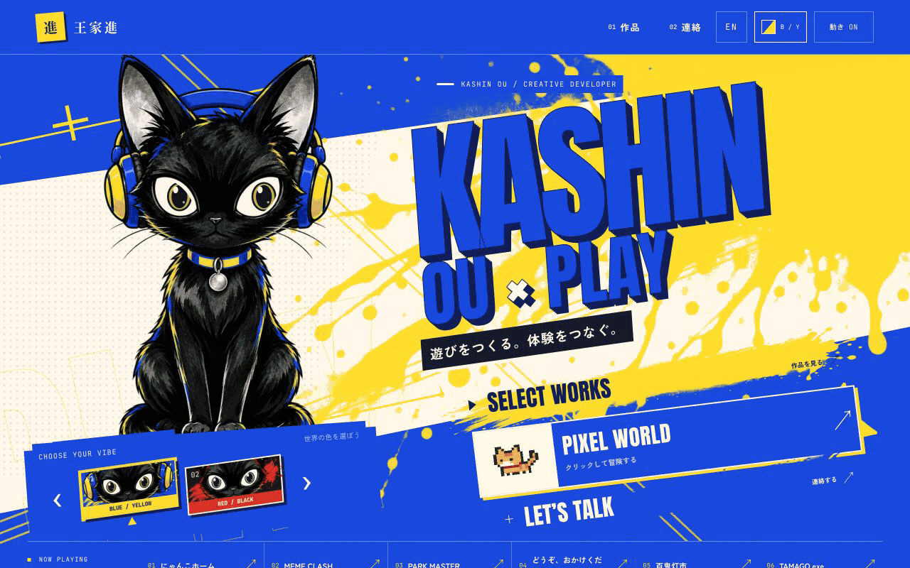

# KASHIN.INK — 遊びをつくる。体験をつなぐ。

王家進（Kashin Ou）の、触って楽しめる個人ポートフォリオです。
作品を一覧で紹介するだけでなく、配色を選ぶ、猫と目が合う、町を歩いて作品に出会う、といった小さな体験から、制作で大切にしている遊び心を伝えることを目指しています。

**[サイトを見る](https://kashin.ink/) · [制作の考え方を読む](https://kashin.ink/works/kashin-ink) · [2Dピクセルワールドで遊ぶ](https://kashin.ink/world)**



## なぜ、この形にしたのか

ゲームやWebをつくる人の作品集だからこそ、サイト自身もひとつの作品として見せたい。
そのため、すぐに作品を読める通常のページと、寄り道しながら発見する小さな2Dワールドを用意しました。探索は任意です。情報を探す人に、ゲームのプレイを強制しないことも大切にしています。

## UI・インタラクション

- **2つの配色**：BLUE / YELLOWとRED / BLACKを切り替えられます。大きな見出し、斜めの構図、スプレーのテクスチャで、ゲームのメニューのような勢いをつくっています。
- **案内役の黒猫**：配色に合わせて姿が変わり、瞳がポインターを追います。ページに「反応してくれる相手」を置くための表現です。
- **スクロールとの連動**：章の切り替え、見出し、背景がスクロール位置に対応します。一方向に再生するだけでなく、戻る操作にも応答します。
- **作品は原色のまま**：作品のGIFや画面までテーマ色に染めず、実際の見た目を伝えます。
- **HTMLとCanvasの役割分担**：文章やリンクはHTMLで保ち、Canvasは画面遷移の演出や2Dワールドに使います。
- **読めることを優先**：日英切り替え、キーボード操作、スマートフォン表示、OSとサイト内の動きを減らす設定に対応します。

## NEKO TOWN — 猫になって、よりみち

現在の`/world`はCanvas2Dで描くピクセルワールドです。以前試作した3Dの島から、猫の見やすさ、親しみやすさ、移動と会話のわかりやすさを重視する方向へ見直しました。

- WASD・矢印キーで歩く。クリック・タップで行き先を選ぶ。
- 住民や掲示板の近くでE・Space、または画面のボタンで調べる。
- 池では魚の反応を待って引き上げ、作品につながる便りを見つける。
- 発見した情報は手帳にまとまり、このブラウザに保存される。
- スコアや制限時間に追われず、いつでも通常の作品集へ戻れる。

入口の美術も、情報量の多い背景から、少ない色と大きなピクセルで読める茶トラ猫へ整理しました。演出を増やすことだけでなく、不要なものを減らすことも制作の一部です。

## 技術構成

| 役割 | 主な技術 |
| --- | --- |
| ページ・コンポーネント | Next.js15 / React19 / TypeScript |
| 日英ルーティング | next-intl |
| スクロール・演出 | GSAP / ScrollTrigger / Lenis / CSS |
| 画面遷移の描画 | html2canvas / Canvas |
| 探索ワールド | Canvas2D / 独立した入力・移動・マップ処理 |
| 検証・配信 | Node.jsのテストランナー / ESLint / Vercel |

ワールドは専用ルートで遅延読み込みし、通常ページの閲覧に必要なものと分けています。過去の3D試作用ファイルが一部残っていますが、公開中の探索体験は2D版です。

## ローカルで動かす

Node.jsとnpmを用意して、リポジトリのルートで実行します。

```sh
npm ci
npm run dev
```

開発サーバーに表示されたURLをブラウザで開いてください。

```sh
npm test
npm run lint
npm run build
npm run start
```

テストはTypeScriptを直接読むため、その機能を備えたNode.jsを使用してください。依存関係の固定には`package-lock.json`を使います。秘密情報やローカル環境ファイルはコミットしません。

## 構成

```text
src/content/                 作品データ・制作の考え方
src/components/sections/     ホームの章・世界への入口
src/components/works/        作品カード・詳細表示
src/components/motion/       視線・スクロール・ページ遷移
src/components/world/pixel/  2Dワールドの描画・移動・入力・マップ
public/assets/              公開用画像・GIF
tests/                      振る舞い・コンテンツ・表示の回帰テスト
```

## 制作について

構想、体験の方向づけ、UIの選定と改善を行いながら、実装や美術制作にAIを活用しています。生成した絵をそのまま完成扱いにせず、配色、ピクセルの大きさ、表示サイズ、読みやすさを実際のサイト上で調整しています。入口の画像の生成・加工記録は[`docs/assets/pixel-world-invitation.json`](docs/assets/pixel-world-invitation.json)に記載しています。

このREADMEは、第三者の商標や素材の権利を譲渡するものではありません。作品ごとの権利・参考元は、各作品ページの記載を確認してください。

## Links

- Website: <https://kashin.ink/>
- Pixel world: <https://kashin.ink/world>
- Repository: <https://github.com/kash1n-tianxie/neko-portfolio>
- GitHub profile: <https://github.com/kash1n-tianxie>
